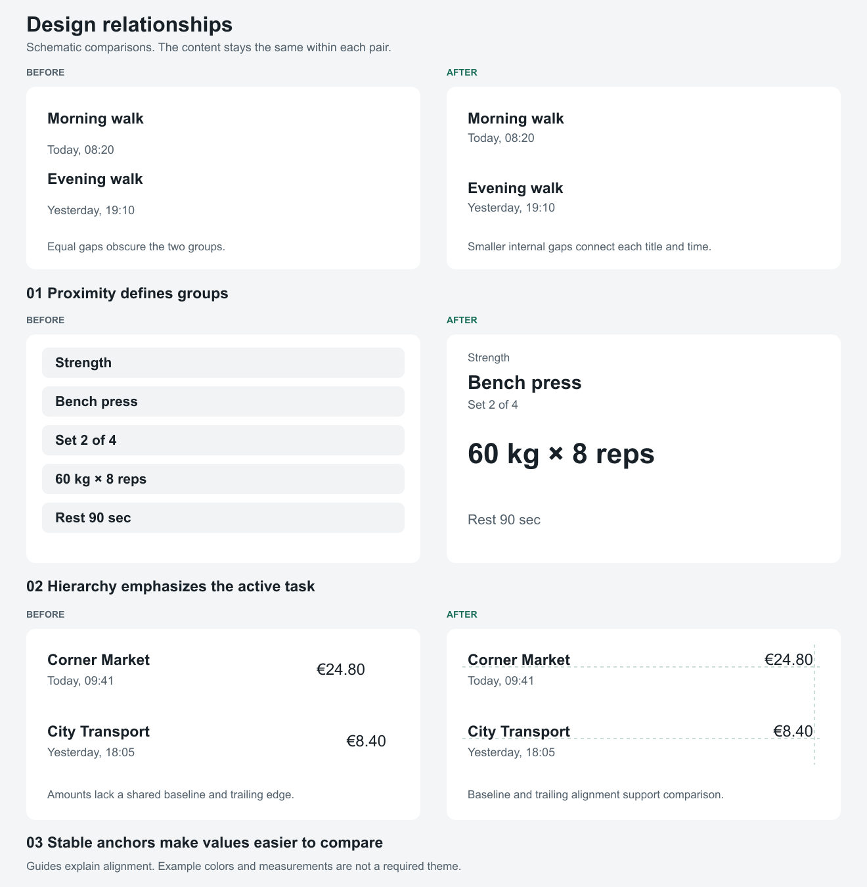

# Visual examples

Open the image when you need a visual comparison. These diagrams illustrate relationships. They are not screenshots, production components, or evidence of tested iOS behavior.

The [SVG source](examples/design-comparisons.svg) keeps the diagrams editable. Use the PNG with image tools that cannot show SVG files.

## Pair 1: Group titles with their metadata

Both sides contain the same two activities and timestamps. The first side uses equal gaps between all four lines. The second side places each timestamp closer to its title. The larger gap separates the two activities.

Apply this relationship to repeated content groups. Do not copy the exact gaps without checking text size and content length.

## Pair 2: Emphasize the active task

Both sides contain the same exercise, set, load, repetitions, and rest information. The first side gives each value a similar container and emphasis. The second side makes the current load and repetitions dominant. Supporting information remains visible.

Use this approach when one task needs priority. Preserve equal emphasis when the user needs to compare peers.

## Pair 3: Align comparable values

Both sides contain the same merchants, dates, and amounts. On the first side, amounts have different trailing edges and align between the title and date. On the second side, amounts share a trailing edge and align with the merchant baselines. The guides show the intended alignment.

Keep dates secondary without making them unreadable. Check wrapped merchant names separately. The guides belong to this diagram, not to the product interface.

## Use the examples selectively

1. Identify the relationship that matches the current defect.
2. Apply that relationship within the existing design system.
3. Check the render with the original content.
4. Check the changed layout with longer content and larger text.

These examples do not prescribe a palette, type scale, or universal screen layout.
